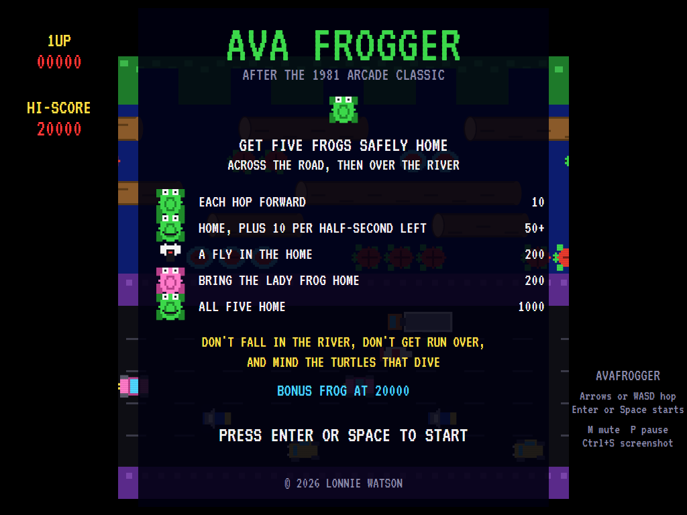
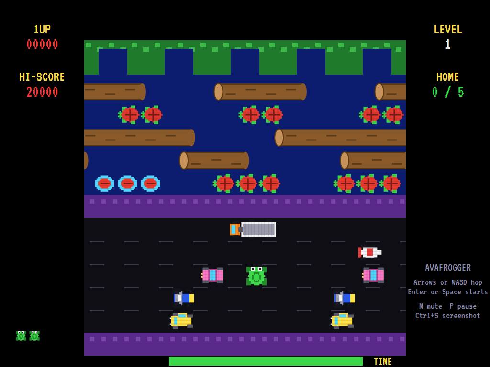
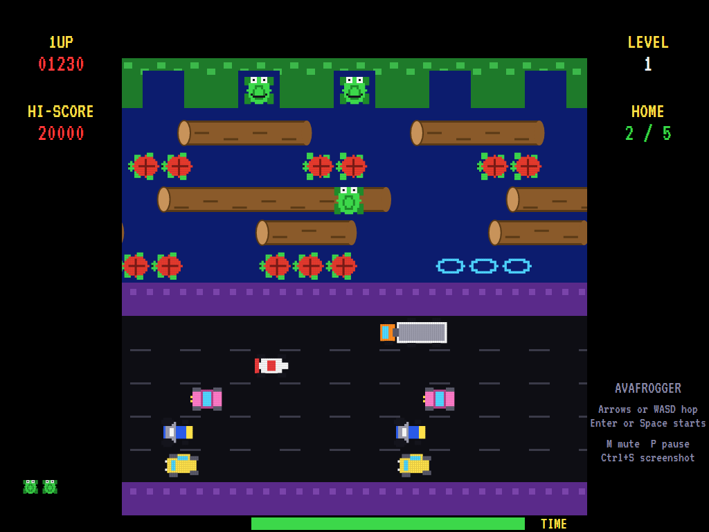
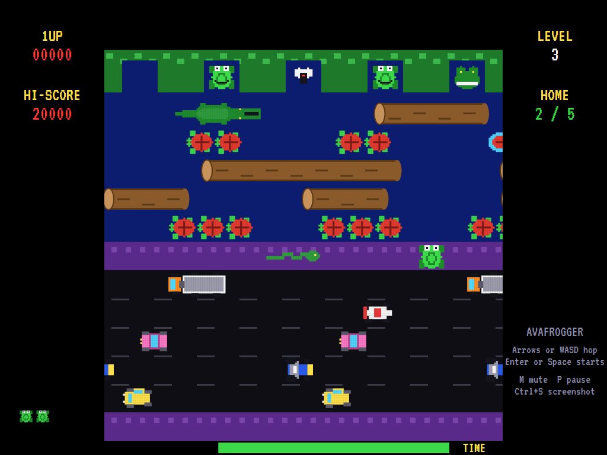
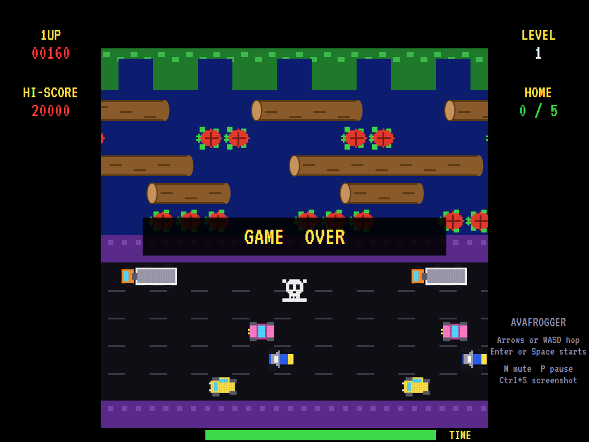
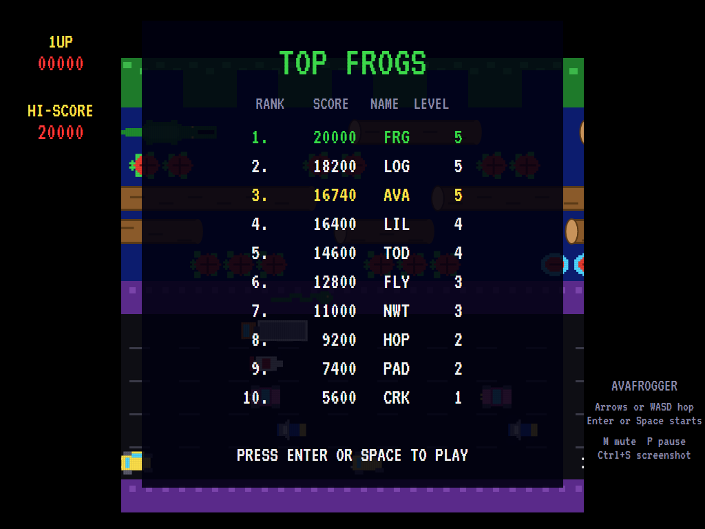

# AVAFrogger

[](https://github.com/Harlock123/AVAFrogger/actions/workflows/build.yml)

A road-and-river crossing game in the style of Konami and Sega's 1981 arcade game **Frogger**, built
with .NET 10 and Avalonia UI. Get five frogs safely home: hop across five lanes of traffic, rest on the
median, then cross the river on logs and the backs of turtles to the five homes in the hedge.

## Features

- **The road**: five lanes, each going its own way at its own pace: sedans, tractors, coupés, a racer
  that comes through fast, and long trucks.
- **The river**: logs, short and long, and rafts of turtles. Some turtles **dive**: they sink, stay
  under for a moment, and come back up, and a frog on them goes under too. Ride anything off the edge
  of the screen and the frog is lost.
- **Homes**: five bays in the hedge. Land in an empty one, not on the hedge or in a home already taken.
  A **fly** sometimes visits an empty home, worth 200 more, and from level 2 a **crocodile** sometimes
  lurks in one.
- **The lady frog** sometimes rides a log. Hop onto her log next to her and bring her home for 200.
- **Levels**: fill all five homes for a 1000 bonus and the next level, which is faster. From level 2 a
  **crocodile** swims among the top row's logs; you can ride its back, but not its head when the jaws
  are open. A **snake** also slithers along the median from level 2, more turtles dive, and from level
  3 there's a second racer.
- **The clock**: 30 seconds per frog, shown on the bar along the bottom. Time left when you reach home
  scores 10 points for every half second.
- **Music**: an original bouncy tune plays while you cross, plus a title tune and fanfares, all mixed by
  OpenAL.
- **Attract mode**: leave the title alone for 15 seconds and a computer player plays a demonstration,
  with all its sounds. Every lane moves at a steady speed, so it looks ahead to judge each hop, and it
  regularly clears whole levels.
- **Three frogs**, a bonus frog at 20,000, and a **top-ten high-score table** with arcade-style
  initials entry.
- **Any window size**: the screen scales to fit, letterboxed. **Ctrl+S** saves a screenshot.
- **One self-contained executable** per platform: Windows, macOS and Linux on Intel/AMD and ARM.

The sprites, sounds and tunes are all this game's own.

## Screenshots

| Title screen | On the road | Over the river |
|:------------:|:-----------:|:--------------:|
|  |  |  |
| The rules and what everything is worth. | Halfway across the traffic. | Riding a log, with two frogs home. |

| Level 3 | Game over | The high-score table |
|:-------:|:---------:|:--------------------:|
|  |  |  |
| A crocodile among the logs, the snake on the median, a fly and a crocodile in the homes. | Out of frogs. | The new entry flashes in the table. |

The screenshots are made by the tests, which play the game in a real (headless) window; see
[Tests](#tests).

## Download and run

Ready-to-run builds for Windows, macOS and Linux, on both Intel/AMD and ARM, are on the
[Releases page](https://github.com/Harlock123/AVAFrogger/releases/tag/latest). **Latest build** is
rebuilt on every push to `main`. Each download is one self-contained executable: no .NET install is
needed.

| Platform | Archive |
|---|---|
| Windows | `AVAFrogger-win-x64.zip`, `AVAFrogger-win-x86.zip`, `AVAFrogger-win-arm64.zip` |
| macOS | `AVAFrogger-osx-arm64.tar.gz` (Apple silicon), `AVAFrogger-osx-x64.tar.gz` (Intel) |
| Linux | `AVAFrogger-linux-x64.tar.gz`, `AVAFrogger-linux-arm64.tar.gz`, `AVAFrogger-linux-arm.tar.gz` |

```bash
tar -xzf AVAFrogger-linux-x64.tar.gz     # or linux-arm64, linux-arm, osx-arm64, osx-x64
./AVAFrogger
```

On Windows, unzip and run `AVAFrogger.exe`. On macOS, if Gatekeeper refuses to open it, run
`xattr -d com.apple.quarantine AVAFrogger` once. Run with `--no-audio` for silence.

**Sound** comes through OpenAL Soft, built in for every platform. In a virtual machine the game
detects it and uses a larger audio buffer, so the sound doesn't break up.

**Gamepads** use SDL2, which is bundled for Windows, macOS and Intel/AMD Linux. ARM Linux builds need it
installed; without it the keyboard still works:

```bash
sudo apt install libsdl2-dev            # Debian / Ubuntu / Raspberry Pi OS
sudo pacman -S --needed sdl2-compat     # Arch / Omarchy
```

## Controls

| Input | Action |
|-------|--------|
| **Arrow keys** / **WASD** | Hop (hold to keep hopping) |
| **Enter** / **Space** | Start a game |
| **P** / **Esc** | Pause (Esc again to quit) |
| **M** | Mute |
| **Ctrl+S** / **Cmd+S** | Save a screenshot to the Pictures folder |

**Gamepad**: the left stick or D-pad hops, **Start** or **A** starts, **Start** pauses, **Back** (while
paused) quits.

**Entering initials**: type letters, or dial with **Up**/**Down** and accept with **Space**; **Left** /
**Backspace** go back; **Enter** finishes.

## Scoring

| What | Points |
|---|---:|
| Each hop forward onto a row this frog hasn't reached yet | 10 |
| Reaching a home | 50, plus 10 for every half second left |
| A fly in the home | 200 |
| Bringing the lady frog home | 200 |
| All five homes filled | 1000 |

## Tests

```bash
dotnet test AVAFrogger.slnx
```

The engine has no UI and runs in fixed 60 Hz steps, so it plays the same at any frame rate, and a seed
always plays the same game. The tests check:

- the board;
- hopping and scoring for new rows, being run over, riding logs, drowning, and being carried off the
  edge;
- diving turtles, and crocodiles' backs and jaws;
- the homes: points, flies, the hedge, full homes and lurking crocodiles;
- clearing a level, the lady frog, the snake, running out of time, and the bonus frog;
- the title tune, the demonstration's sound, pausing the music, and every sound and sprite.

A computer player (the attract-mode one) plays whole games in them and must get five frogs home.

The screenshot tests draw the real screen in a headless window. To refresh the README's pictures:

```bash
FROGGER_SHOTS=$PWD/Images dotnet test tests/AVAFrogger.Tests --filter ScreenshotTests
```

## Building

```bash
dotnet build AVAFrogger.slnx
dotnet run --project src/AVAFrogger
```

Needs the .NET 10 SDK. The sounds are made by `tools/make_sounds.py` (standard-library Python):
`python3 tools/make_sounds.py` rewrites `src/AVAFrogger/Sounds`.

## Project structure

```
AVAFrogger/
├── AVAFrogger.slnx
├── src/AVAFrogger/
│   ├── Engine/
│   │   ├── GameEngine.cs        # States, scoring, the bonus frog and the music
│   │   ├── GameEngine.Play.cs   # Hopping, riding, what ends a frog, the homes, flies, crocodiles,
│   │   │                        # the lady frog, the snake, the clock and the levels
│   │   ├── Entities.cs          # The frog, the homes, the snake and the lady
│   │   ├── AttractPilot.cs      # The computer player for the demonstration (and the tests)
│   │   ├── HighScoreTable.cs, InitialsEntry.cs
│   │   ├── InputHandler.cs, ControllerManager.cs  # Keys and an SDL2 gamepad
│   │   └── SoundManager.cs      # Effects, tunes and the crossing music through OpenAL
│   ├── Audio/                   # The OpenAL engine (from the author's AVABand)
│   ├── Models/                  # The board, the lanes for each level, and the pixel art
│   ├── Views/                   # The screen: the board, the traffic and river, panels, title and tables
│   └── Sounds/                  # The synthesised effects and tunes
├── tests/AVAFrogger.Tests/      # Gameplay and screenshot tests
├── tools/make_sounds.py
└── Images/                      # Screenshots
```

## About and licence

AVAFrogger © 2026 Lonnie Watson, under the [MIT License](LICENSE).

*Frogger* © 1981 Konami; the name belongs to its owner. AVAFrogger is an independent, unofficial game in
its style. Its sprites, sounds, tunes and code are its own; nothing is taken from the arcade machine's
program, graphics or sound. It is not affiliated with or endorsed by any rights holder.

Bundled components keep their own licences: the VT323 font (SIL Open Font License 1.1, by Peter Hull;
`src/AVAFrogger/Assets/Fonts/VT323-OFL.txt`), OpenAL Soft (LGPL-2.0-or-later; loaded as a separate
library; `src/AVAFrogger/Audio/native/COPYING-openal-soft.txt`), and the MIT-licensed Avalonia,
Silk.NET, NVorbis, NLayer and SDL2-CS (with SDL2 under the zlib licence).
